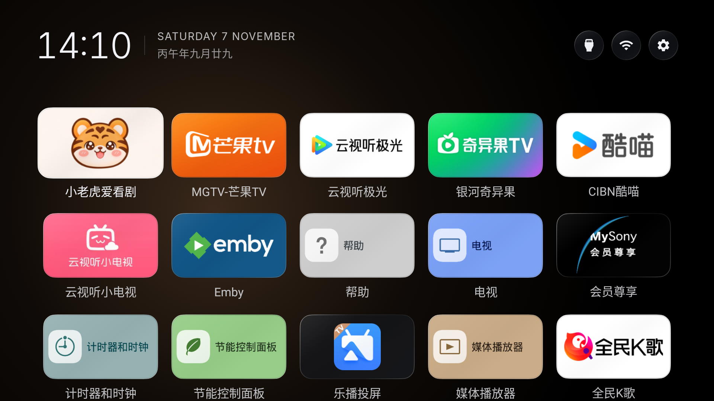

<p align="center">
  
</p>

Interlude is a minimal Android TV launcher for Android 14 and later.



## Install

Download `Interlude-1.0.5.apk` from [Releases](https://github.com/qvshuo/Interlude/releases/tag/v1.0.5) and sideload it on an Android 14 or later ARM TV. With Android debugging enabled, install or update with:

```sh
adb install -r Interlude-1.0.5.apk
```

Choose Interlude as the default Home app using your TV's launcher settings. Availability and naming vary by manufacturer. Keep the stock launcher installed. Updates signed with the same certificate preserve your Home selection and launch history; clearing app data removes them.

## Use

- Move with the D-pad; press OK to open an app or header button.
- Hold OK on an app to remove it from Home. Hold Settings to show all apps, then hold OK on a removed app to add it back.
- Hold Settings again to return to Home apps. Home returns to the first app; Back keeps your current position.
- Inputs, Network, and Settings open the TV's system pages.

See [APP_DESIGN.md](APP_DESIGN.md) for full product behavior and visual specifications, [AGENTS.md](AGENTS.md) for development and build instructions, and [VALIDATION.md](VALIDATION.md) for test and release evidence.

Interlude and its reused icon/corner code are covered by [LICENSE](LICENSE). Bundled Inter fonts have a separate [SIL Open Font License](app/src/main/assets/INTER-LICENSE.txt).
